# BullyBlock

<p align="center">
  <a href="https://bullyblock-mu.vercel.app/" target="_blank" rel="noreferrer">
    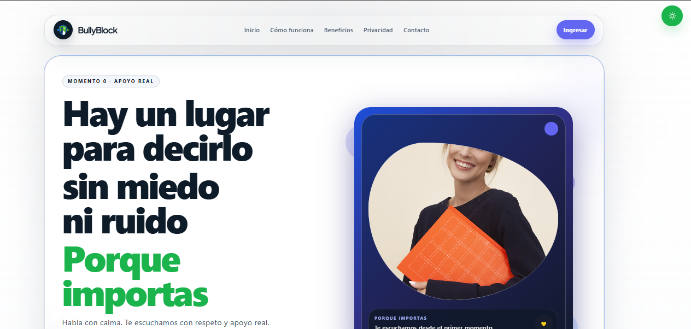
  </a>
</p>

<p align="center">
  <a href="https://bullyblock-mu.vercel.app/" target="_blank" rel="noreferrer">
    
  </a>
  <a href="https://github.com/isyoimerr/bullyblock" target="_blank" rel="noreferrer">
    
  </a>
</p>

<p align="center">
  <strong>Open the app:</strong> <a href="https://bullyblock-mu.vercel.app/">https://bullyblock-mu.vercel.app/</a>
</p>

<p align="center">
  
  
  
</p>

## Live Demo

BullyBlock is already deployed and available for testing in production.

This live environment is meant for quick validation of the onboarding flow, student reporting experience, educator dashboard, and institutional response workflow in a real deployment context.

## Mobile Experience

This product is designed to feel comfortable on mobile devices, with large touch targets, reduced visual clutter, and clear flows for urgent situations.

<p align="center">
  <a href="https://bullyblock-mu.vercel.app/" target="_blank" rel="noreferrer">
    
  </a>
</p>

> For an even stronger product presentation, a short MP4 or GIF recording of the app in mobile mode can be added here after upload.

## Project Core Intent

BullyBlock is a mobile-first school wellbeing and reporting platform designed to protect students and improve institutional response. The core purpose is simple and urgent: students can report risk situations without fear, and the institution can respond with empathy, order, and absolute clarity.

This project was built to reduce uncertainty in sensitive situations, ensure that no incident is ignored or lost in informal communication, and give school staff a clear system for accompaniment, triage, and follow-up.

## Why this project matters

- Students can report bullying, exclusion, intimidation, or risk without facing confusion or pressure.
- Teachers and support staff can follow a structured process instead of relying on fragmented communication.
- The school can prioritize interventions with context, traceability, and clarity.
- The experience is designed for mobile use, clarity, and emotional safety.

## Role Architecture

| Role | Focus | Responsibility |
| --- | --- | --- |
| Estudiante | Reporting and support | Reports situations, receives guidance, and tracks case status. |
| Docente | Daily accompaniment | Follows context, identifies patterns, and supports referrals. |
| Psicorientación | Risk intervention | Reviews sensitive cases, prioritizes attention, and provides human accompaniment. |
| Admin | Institutional oversight | Monitors overall system flow, reports, and operational visibility. |

## UI Gallery

<p align="center">
  
  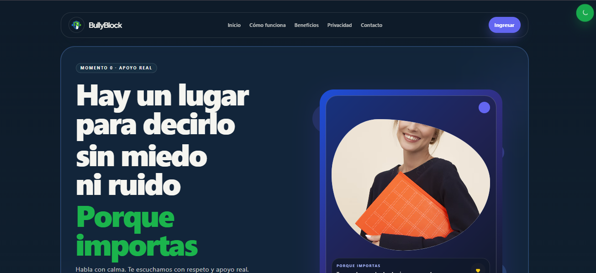
  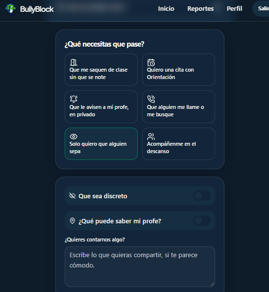
</p>

<p align="center">
  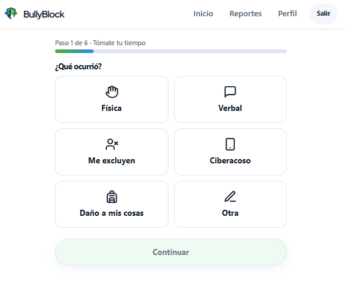
  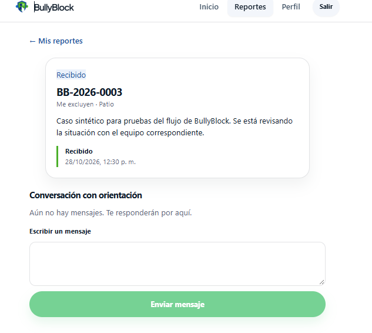
  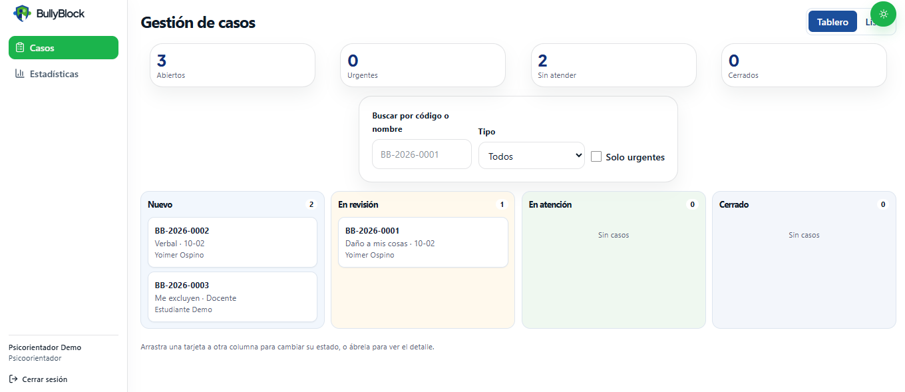
</p>

<p align="center">
  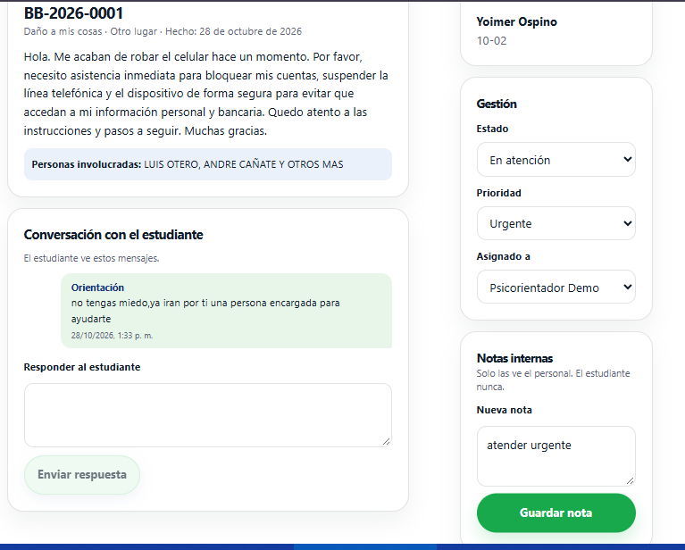
  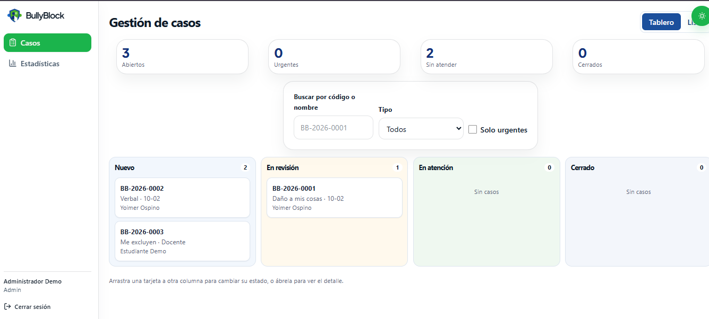
  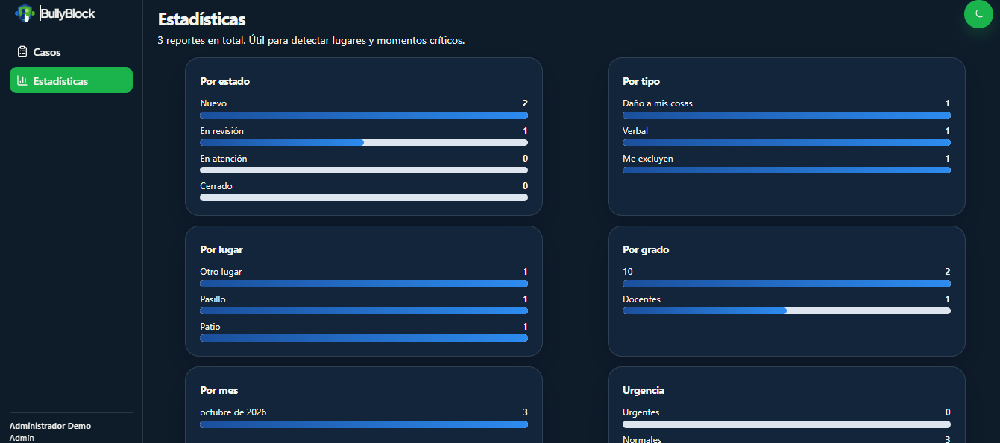
</p>

<p align="center">
  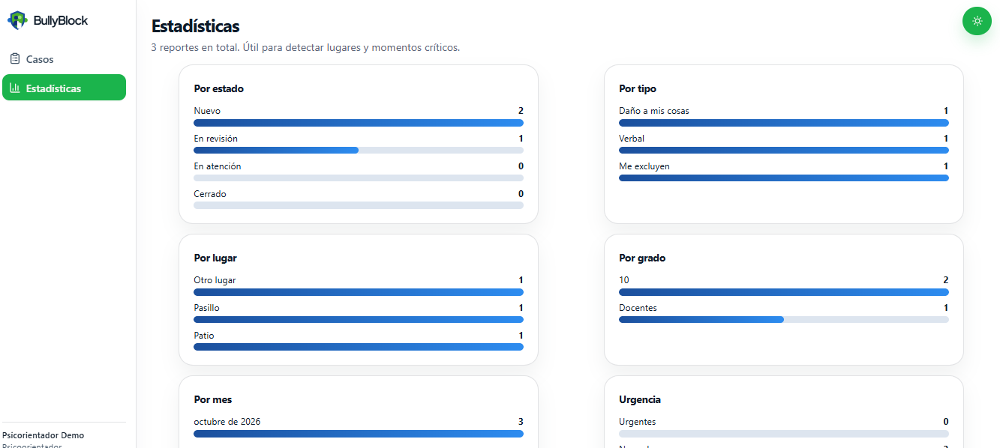
  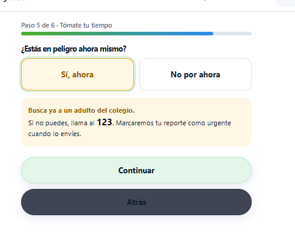
</p>

## Product Experience

BullyBlock is designed as a guided, low-friction experience for people in stressful situations. Each screen is built to help the user understand what is happening, what action to take next, and who can help them.

### Core user flow

1. The student enters the app.
2. The person describes the situation in a clear and structured way.
3. The report is registered with context and safety signals.
4. The educational team reviews and prioritizes the case.
5. The institution accompanies the student with order, empathy, and follow-up.

The result is a safer, clearer, and more organized response to risk and wellbeing situations in the school environment.

## Tech Stack

<p align="center">
  
  
  
  
  
  
  
</p>

## Project Context

This project is associated with the educational institution:

**Institución Educativa Técnica José Agustín Blanco Barros**

The application is designed to support student wellbeing, institutional response, and a safe communication channel for reporting risk situations inside the school ecosystem.

## Contributors

This repository is open to collaboration and community contribution.

[View contributors](https://github.com/isyoimerr/bullyblock/graphs/contributors)

## Getting Started

```bash
git clone https://github.com/isyoimerr/bullyblock.git
cd bullyblock
npm install
npm run dev
```

### Environment variables

```env
VITE_SUPABASE_URL=https://tu-proyecto.supabase.co
VITE_SUPABASE_ANON_KEY=tu-clave-anon-publica
```

> Keep all secrets and service-role credentials out of the repository.

## Project Structure

```text
bullyblock/
├─ docs/
│  ├─ README.md
│  ├─ github-banner.svg
│  ├─ app-preview.svg
│  ├─ screenshots/
│  │  ├─ home-claro.png
│  │  ├─ home-oscuro.png
│  │  ├─ ayuda-estudiante.png
│  │  ├─ registro-situacion.png
│  │  ├─ reportes-estudiante.png
│  │  ├─ panel-docente.png
│  │  ├─ estadisticas-docente.png
│  │  ├─ panel-psicorientador.png
│  │  ├─ panel-admin.png
│  │  ├─ estadisticas-admin.png
│  │  └─ peligro-mensaje-estudiante.png
│  ├─ 01-arquitectura-software.md
│  ├─ 02-ui-ux-roadmap.md
│  ├─ 03-base-datos-supabase.md
│  ├─ 04-github-vercel.md
│  └─ 05-checklist.md
├─ public/
├─ scripts/
│  └─ theme-regression.test.mjs
├─ src/
│  ├─ App.tsx
│  ├─ components/
│  ├─ lib/
│  ├─ pages/
│  ├─ index.css
│  └─ main.tsx
├─ supabase/
│  ├─ schema.sql
│  ├─ seed.sql
│  ├─ staff.sql
│  └─ safe-roles-migration.sql
├─ index.html
├─ package.json
├─ tailwind.config.js
├─ tsconfig.json
├─ vite.config.ts
├─ vercel.json
├─ README.md
└─ build-log.txt
```

## Institutional License

© 2026 **Institución Educativa Técnica José Agustín Blanco Barros**. All rights reserved.

This repository and the associated project assets are the property of the institution for educational, operational, and institutional use. Any reuse, adaptation, redistribution, or commercial exploitation must be previously authorized in writing by the institution.

## Status

- Mobile-first UX: active
- Institutional reporting flow: active
- Multi-role access model: active
- Visual dashboard and reporting system: active
- Production-ready deployment pathway: active

