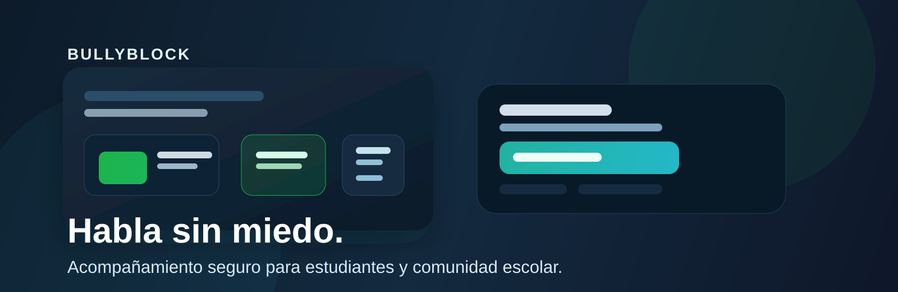
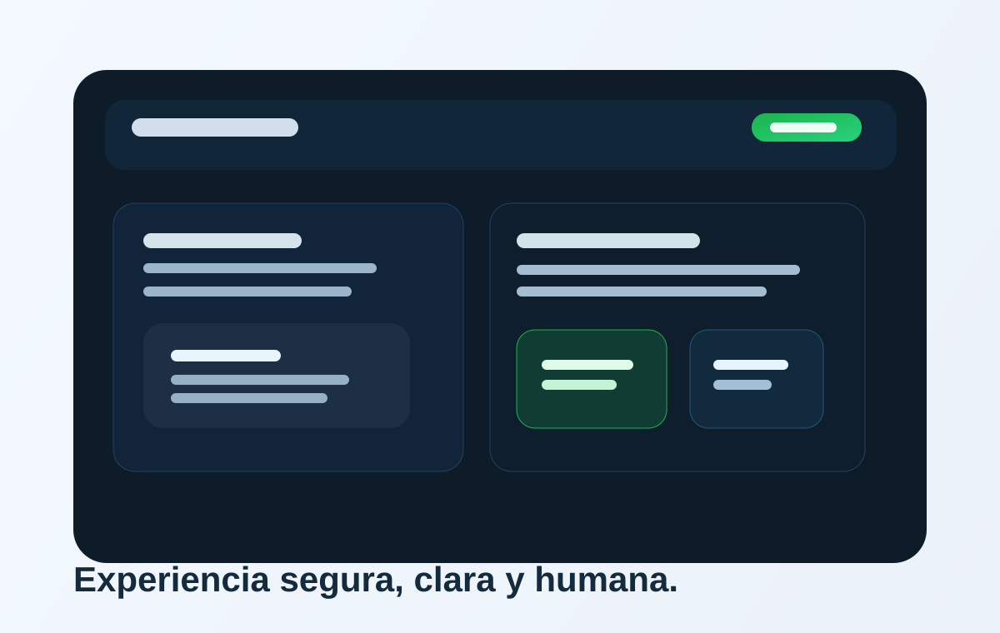

<p align="center">
  
</p>

<div align="center">

[](https://react.dev)
[](https://www.typescriptlang.org/)
[](https://vite.dev)
[](https://supabase.com)
[](https://vercel.com)

</div>

# BullyBlock

Aplicación web móvil primero para prevenir, denunciar y acompañar situaciones de acoso escolar con una experiencia clara, accesible y segura para estudiantes, docentes, orientación y administración.

BullyBlock permite que la comunidad educativa reporte hechos con calma, reciba apoyo real y centralice la gestión de casos con una interfaz moderna y amigable.

## ✨ ¿Qué hace?

- Registro e ingreso con roles diferenciados
- Reportes de bullying o situaciones de riesgo
- Seguimiento de casos por el personal institucional
- Comunicación interna segura entre estudiante y equipo escolar
- Panel privado para orientación y administración
- Diseño responsive para móvil y escritorio
- Tema claro/oscuro con enfoque en accesibilidad y navegación táctil

## 🧩 Roles del sistema

| Rol | Función principal |
| --- | --- |
| estudiante | Reporta situaciones y consulta el estado de su caso |
| docente | Acompaña, informa y alerta cuando se detecta una necesidad |
| psicoorientador | Revisa, asigna y gestiona casos con seguimiento |
| admin | Administración del sistema y gestión de usuarios |

## 🛠️ Stack tecnológico

- React 18
- TypeScript
- Vite
- Tailwind CSS
- Supabase Auth + PostgreSQL + RLS
- Vercel
- Lucide React

## 📸 Vista previa

<p align="center">
  
</p>

## 🚀 Inicio rápido

```bash
git clone https://github.com/isyoimerr/bullyblock.git
cd bullyblock
npm install
cp .env.example .env
npm run dev
```

## ⚙️ Variables de entorno

La app está conectada exclusivamente a Supabase en producción real. Debes configurar la URL y la anon key del proyecto real.

```env
VITE_SUPABASE_URL=https://tu-proyecto.supabase.co
VITE_SUPABASE_ANON_KEY=tu-clave-anon-public
```

> Nunca uses la service role en el frontend ni la publiques en GitHub.

## 🗄️ Base de datos en Supabase

Ejecuta los archivos SQL en este orden:

```sql
supabase/schema.sql
supabase/staff.sql
supabase/seed.sql
```

- Authentication > Users: crea usuarios de personal
- SQL Editor: ejecuta los scripts de esquema y roles
- Project Settings > API: copia URL y anon key

## ☁️ Despliegue en Vercel

1. Importa el repositorio en Vercel
2. Selecciona el framework Vite
3. Usa estas configuraciones:
   - Build Command: `npm run build`
   - Output Directory: `dist`
4. Agrega estas variables de entorno:
   - `VITE_SUPABASE_URL`
   - `VITE_SUPABASE_ANON_KEY`
5. Haz deploy

### Config real de producción

- `VITE_SUPABASE_URL=https://tu-proyecto.supabase.co`
- `VITE_SUPABASE_ANON_KEY=tu-anon-key-publica`

## 📁 Estructura del proyecto

```text
bullyblock/
├─ docs/
│  ├─ github-banner.svg
│  ├─ app-preview.svg
│  ├─ README.md
│  ├─ 01-arquitectura-software.md
│  ├─ 02-ui-ux-roadmap.md
│  ├─ 03-base-datos-supabase.md
│  ├─ 04-github-vercel.md
│  └─ 05-checklist.md
├─ scripts/
│  └─ theme-regression.test.mjs
├─ src/
│  ├─ App.tsx
│  ├─ index.css
│  ├─ components/
│  ├─ lib/
│  └─ pages/
├─ supabase/
│  ├─ schema.sql
│  ├─ staff.sql
│  └─ seed.sql
├─ .env.example
├─ .gitignore
├─ index.html
├─ package.json
├─ tailwind.config.js
├─ vercel.json
├─ vite.config.ts
└─ README.md
```

## 🧪 Validación

```bash
npm run test:theme
npm run typecheck
```

## 📘 Documentación adicional

- [docs/README.md](docs/README.md)
- [docs/01-arquitectura-software.md](docs/01-arquitectura-software.md)
- [docs/02-ui-ux-roadmap.md](docs/02-ui-ux-roadmap.md)
- [docs/03-base-datos-supabase.md](docs/03-base-datos-supabase.md)
- [docs/04-github-vercel.md](docs/04-github-vercel.md)
- [docs/05-checklist.md](docs/05-checklist.md)

## 🌍 Objetivo

BullyBlock busca convertirse en una plataforma clara, útil y segura para instituciones educativas que quieren acompañar a estudiantes, prevenir el bullying y mejorar la respuesta institucional con empatía, respeto y organización.

## 🔒 Recomendaciones

- Nunca publiques la clave de servicio de Supabase
- No subas archivos `.env` al repositorio
- Mantén activado el RLS de Supabase en producción
- Usa correo verificado y flujo de autenticación con cuidado

## Licencia

Este proyecto se entrega como base de desarrollo para uso institucional y adaptación. Ajusta la licencia final según la política del colegio o equipo que lo publique.
